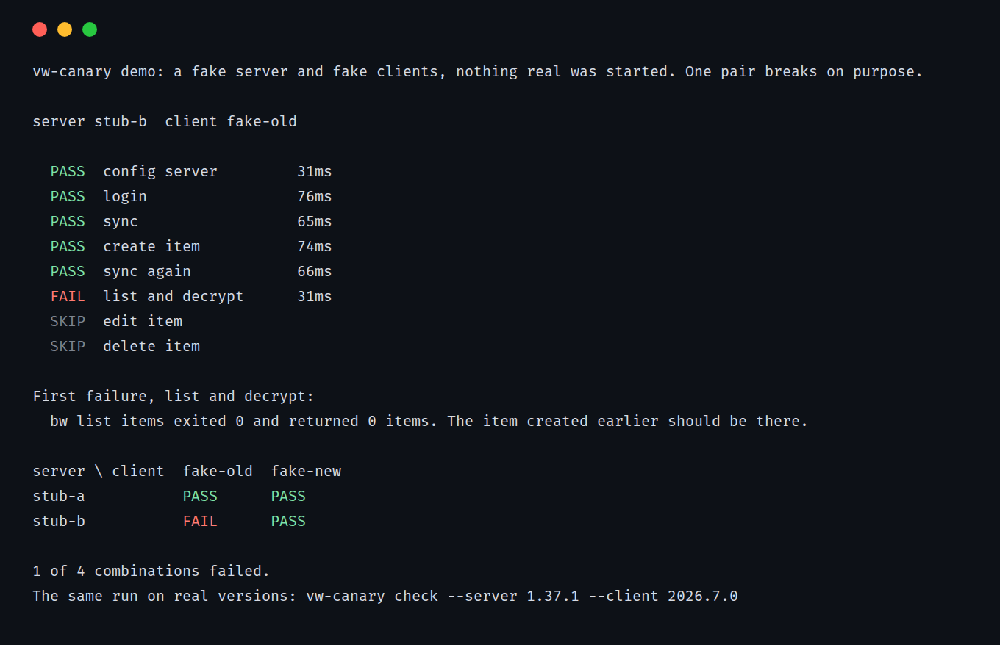

# vw-canary

[](https://github.com/kd-011/vw-canary/actions/workflows/ci.yml)

vw-canary tells you whether a Bitwarden client version still works against a Vaultwarden server version, before you update either. It starts the Vaultwarden version you name in a throwaway container, creates a throwaway account and runs the official Bitwarden CLI through login, sync, create, list, edit and delete.



## Try it

This needs Node 22 or newer and installs nothing:

```sh
npx github:kd-011/vw-canary demo
```

The demo uses a bundled fake server and fake clients, with no Docker and no network. One pair breaks on purpose, so it exits 1.

## Check a real pair

This needs Docker and npm.

```sh
npx github:kd-011/vw-canary check --server 1.37.5 --client 2026.10.1
```

To test a grid, and to get JSON for CI:

```sh
npx github:kd-011/vw-canary check --matrix --servers 1.37.1,1.37.5 --clients 2026.7.0,2026.10.1
npx github:kd-011/vw-canary check --server 1.37.5 --client latest --json
```

Exit codes: 0 everything passed, 1 a client flow failed, 2 something could not be tested. A pair takes about a minute. To keep it around, `npm install -g github:kd-011/vw-canary`. It is not on the npm registry yet.

The container listens on a random port on 127.0.0.1, keeps its data in memory and is removed on exit. The client runs with a private `HOME` and never sees your Bitwarden config. There is no option to point it at a real server.

## What it found

I ran these on 2026-11-03 on Linux, with the official images and the npm packages. A blank cell is a pair I did not run.

| server \ client | 2026.1.0 | 2026.4.2 | 2026.5.0 | 2026.6.0 | 2026.7.0 | 2026.8.0 | 2026.9.1 | 2026.10.1 |
| --- | --- | --- | --- | --- | --- | --- | --- | --- |
| 1.34.3 | PASS | FAIL | FAIL |  |  |  |  |  |
| 1.35.6 | PASS | FAIL | FAIL | FAIL | FAIL | FAIL |  | FAIL |
| 1.36.0 |  |  |  | PASS | FAIL | FAIL |  | FAIL |
| 1.37.1 |  |  |  | PASS | PASS | PASS |  | FAIL |
| 1.37.2 |  |  |  |  |  |  | FAIL | FAIL |
| 1.37.3 |  |  |  |  |  |  | FAIL | FAIL |
| 1.37.4 |  |  |  |  |  |  | PASS | PASS |
| 1.37.5 |  |  |  | PASS | PASS | PASS |  | PASS |

The failures, with the real error text:

- 1.34.3 and 1.35.6 with clients from 2026.4.2 on fail at login with `{"response":null,"statusCode":404}`. The server log shows the client calling `POST /identity/accounts/prelogin/password`. That route is in Vaultwarden's source from 1.36.0.
- 1.36.0 with 2026.7.0 and 2026.8.0 fails at create. The server log shows `POST /api/ciphers` answering 200, then the client crashes with `invalid type: JsValue(Object(...)), expected a string`. Vaultwarden's [1.37.0 release notes](https://github.com/dani-garcia/vaultwarden/releases/tag/1.37.0) say that version is required for clients 2026.7.0 and up (read 2026-11-03).
- 1.36.0 with 2026.10.1 fails at login with `KDF config response does not contain a valid KDF type`.
- 1.37.1 to 1.37.3 with 2026.10.1, and 1.37.2 and 1.37.3 with 2026.9.1, fail at login with `KeyIdBackfillError: API call failed during user key id backfill`. The server log shows `POST /api/accounts/key-management/user-key-id` answering 404. That route is in Vaultwarden's source from 1.37.4, where both clients pass.

## What a PASS means

The CLI flow worked. It does not mean every client works. The CLI shares its API layer with the browser extension, the desktop app and the mobile apps, but it is a different program.

I tested the pair from [Vaultwarden discussion #7529](https://github.com/dani-garcia/vaultwarden/discussions/7529) (read 2026-11-03), where Vaultwarden 1.37.1 with browser extension 2026.7.0 showed an empty vault. With the CLI it did not reproduce: every step passes. The same goes for [issue #7607](https://github.com/dani-garcia/vaultwarden/issues/7607) (read 2026-11-03), 1.37.1 with extension 2026.8.0. So vw-canary would have told you those two pairs were fine, and for extension users they were not.

Treat a FAIL as a reason to hold off updating, and a PASS as one piece of evidence. [docs/limitations.md](docs/limitations.md) has the full list of what it does not check, including organisations, policies, attachments, 2FA, and your own database and proxy.

## How it works

`bw` can't create accounts, so vw-canary registers one itself with `node:crypto`: PBKDF2 master key, stretched with HKDF, a random user key and an RSA key pair, all wrapped the way a client would wrap them. `bw` also refuses plain http, so the container gets a certificate made on the spot for 127.0.0.1. A step fails if `bw` exits non-zero or if what it returns does not match what went in, so an empty vault with exit 0 is still a failure. The details are in [docs/how-it-works.md](docs/how-it-works.md).

If something other than the client goes wrong, such as an image that does not exist or a server that refuses the registration, the result is an ERROR with exit 2, and the client is reported as not tested.

## Docs

- [docs/reference.md](docs/reference.md): commands, accepted versions, exit codes and what each step checks.
- [docs/json-schema.md](docs/json-schema.md): the `--json` document.
- [docs/limitations.md](docs/limitations.md): what it does not check.
- [docs/how-it-works.md](docs/how-it-works.md): the container, the certificate and the registration.

## When not to use it

- You want to know if your browser extension or phone app works. Try it on a spare profile.
- You run a real server and want to test that. It only tests fresh containers, so database migrations and your settings are not covered.
- You are on Windows or macOS. I have only tried it on Linux.

## Contributing

See [CONTRIBUTING.md](CONTRIBUTING.md). `node --test` runs the suite, and [CHANGELOG.md](CHANGELOG.md) lists what changed.

## Licence

MIT, see [LICENSE](LICENSE).
